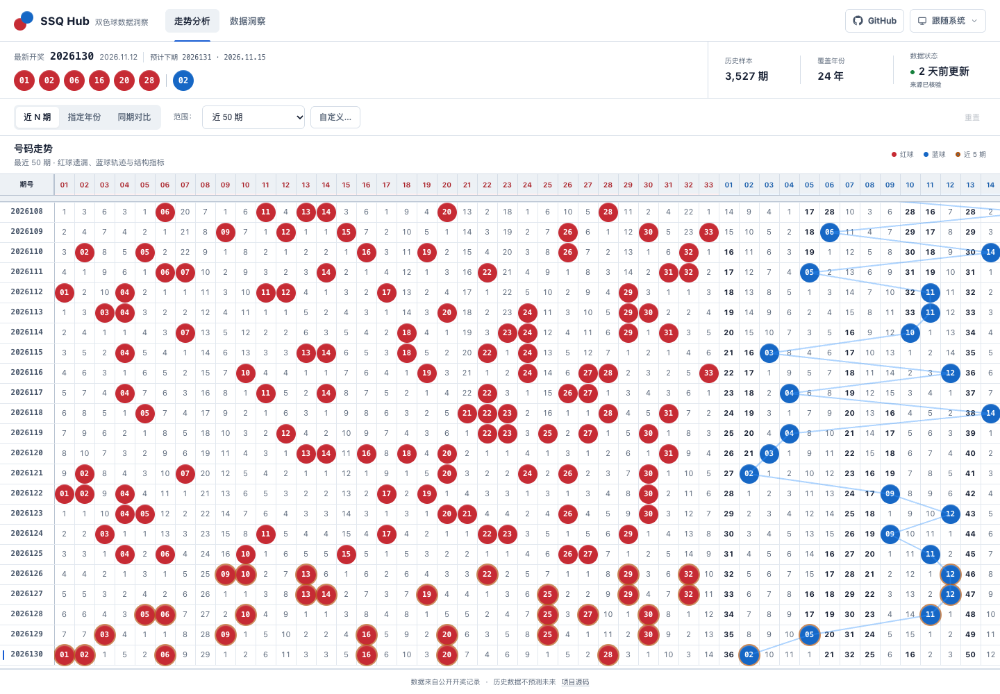
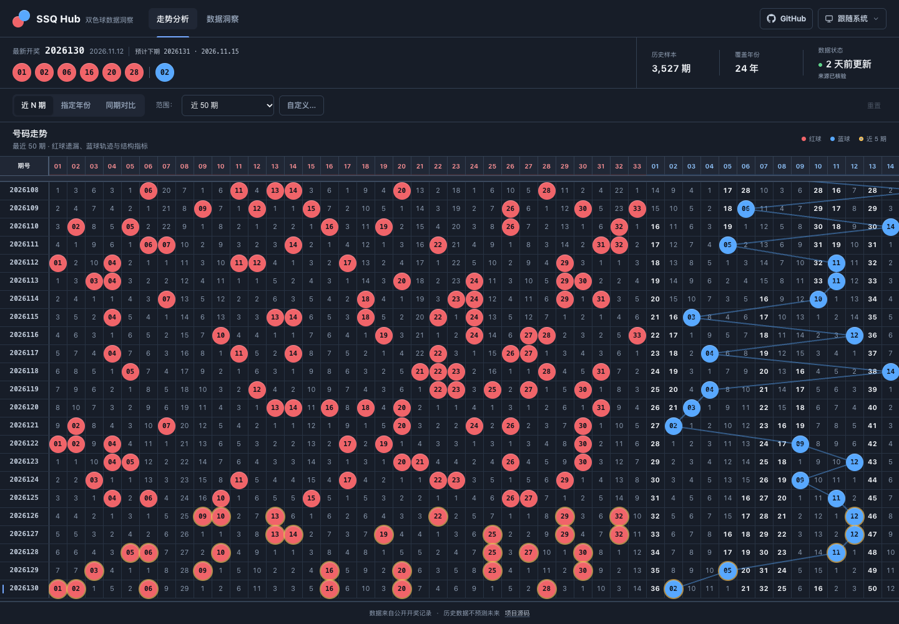
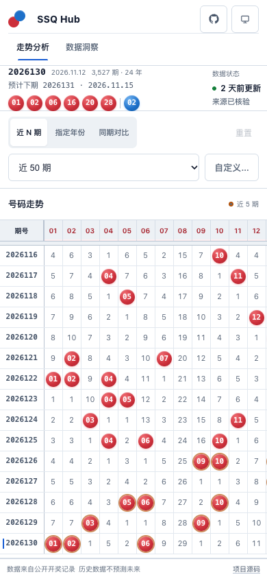
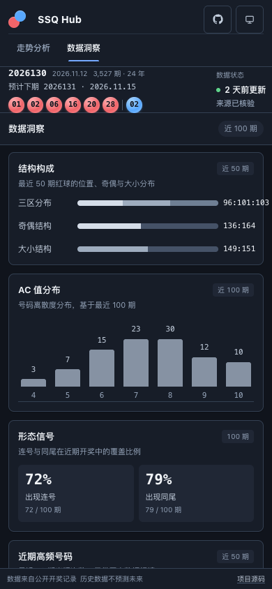
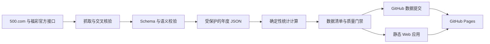

# SSQ Hub · 双色球历史数据分析与可视化

SSQ Hub 是一个面向双色球历史开奖记录的静态数据分析产品。它将 Python 数据采集与校验流程、58 列走势矩阵、号码画像、近期统计、数据洞察和深浅色主题组合在一起，不依赖后端、数据库或前端框架运行时。

> 历史数据只用于查询、统计和可视化，不能预测未来开奖结果。

[](https://github.com/zhouminghan/ssq-hub/actions/workflows/ci.yml)
[](https://github.com/zhouminghan/ssq-hub/actions/workflows/update-data.yml)
[](https://zhouminghan.github.io/ssq-hub/data/latest.json)

## 关于 SSQ Hub

SSQ Hub 的核心目标是让历史开奖数据更容易阅读、筛选、比较和核查，同时明确区分“历史事实”和“未来预测”。

当前产品包含以下主要能力：

- 覆盖 2003 年至今的完整历史开奖记录。
- 58 列走势矩阵：期号、33 个红球、16 个蓝球和 8 个结构指标。
- 红蓝球遗漏、蓝球 SVG 走势线、近 5 期高亮和最新一期自动定位。
- 最近 N 期、指定年份、自定义 N 期和跨年同期对比。
- 号码画像抽屉：全局、近 50 期、近 100 期频次，当前遗漏、最大遗漏和最近 5 次出现。
- 数据洞察：分区、奇偶、大小、AC 值、连号、同尾和近期高频号码。
- 跟随系统、浅色和深色三态主题，用户选择会持久化保存。
- 数据新鲜度、来源核验、缓存回退和 CDN 回退状态。
- 桌面、平板和手机布局，支持表格内部滚动、冻结期号列和吸顶表头。

## GitHub 信息

以下链接与仓库信息已于 2026-11-15 核对：

| 项目 | 信息 |
|---|---|
| GitHub 仓库 | [https://github.com/zhouminghan/ssq-hub](https://github.com/zhouminghan/ssq-hub) |
| GitHub Pages | [https://zhouminghan.github.io/ssq-hub/](https://zhouminghan.github.io/ssq-hub/) |
| 问题反馈 | [https://github.com/zhouminghan/ssq-hub/issues](https://github.com/zhouminghan/ssq-hub/issues) |
| GitHub Actions | [https://github.com/zhouminghan/ssq-hub/actions](https://github.com/zhouminghan/ssq-hub/actions) |
| 默认分支 | `main` |
| 仓库可见性 | 公开 |
| 本地许可证 | [MIT](LICENSE) |

### 仓库 About

GitHub About 当前配置如下：

- 描述：`A modern Double Color Ball historical data analysis and visualization platform with automated data pipelines, statistical insights, and responsive charts.`
- 主页：[https://zhouminghan.github.io/ssq-hub/](https://zhouminghan.github.io/ssq-hub/)
- 主题标签：`lottery`、`ssq`、`data-analysis`、`data-visualization`、`python`、`typescript`、`github-pages`

## 在线演示

生产地址：[https://zhouminghan.github.io/ssq-hub/](https://zhouminghan.github.io/ssq-hub/)

该地址当前可以访问，但线上版本仍是部署前的旧版产品。当前 `codex/product-rebuild` 分支中的重构版本已经在本地完成验证，还需要获得明确的推送授权并通过 GitHub Actions 后，才能更新正式 Pages。

## 产品截图

### 桌面端：浅色主题



### 桌面端：深色主题



### 移动端

<p>
  
  
</p>

## 技术栈

- 运行层：语义化 HTML、原生 ES 模块、原生 DOM/SVG 和 CSS 自定义属性。
- 数据层：Python 3.11+、`requests`、JSON Schema 2020-12。
- 质量层：TypeScript `checkJs`、ESLint、Node Test Runner、Python `unittest`/`pytest`、Ajv、Playwright 和 Axe。
- 交付层：GitHub Actions 与 GitHub Pages。

生产运行时没有应用服务器、数据库或前端框架运行时。技术选择依据见 [技术决策记录](docs/architecture/TECHNICAL_DECISIONS.md)。

## 系统架构



详细设计文档：

- [系统概览](docs/architecture/SYSTEM_OVERVIEW.md)
- [系统架构](docs/architecture/SYSTEM_ARCHITECTURE.md)
- [数据流](docs/architecture/DATA_FLOW.md)
- [前端架构](docs/architecture/FRONTEND_ARCHITECTURE.md)
- [数据管道](docs/architecture/DATA_PIPELINE.md)
- [CI/CD](docs/architecture/CI_CD.md)

## 项目目录

```text
ssq-hub/
├── .github/workflows/       CI、受保护数据更新和 Pages 部署
├── docs/
│   ├── architecture/        系统、数据、前端和交付架构说明
│   ├── development/         本地开发、测试、部署和排障指南
│   ├── harness/             可恢复的任务与证据状态
│   ├── reports/             基线、审计、验收和文件清单
│   └── screenshots/         真实产品截图
├── pocs/                    Vue 3 架构对照实验
├── schemas/                 JSON Schema 2020-12 数据契约
├── scripts/                 数据抓取、统计、清单和验证脚本
├── tests/
│   ├── e2e/                 Playwright 桌面与移动端测试
│   ├── python/              Python 数据与历史保护测试
│   ├── schema/              Ajv JSON Schema 验证
│   └── unit/                浏览器模块单元测试
└── web/
    ├── assets/              图标、Logo 和分享图
    ├── config/              停开奖窗口配置
    ├── css/                 主题变量和组件样式
    ├── data/                年度历史记录与生成数据
    └── js/                  浏览器 ES 模块
```

完整的文件审查、忽略规则和待删除候选见 [项目文件清单](docs/reports/PROJECT_FILE_INVENTORY.md)。

## 本地运行

```bash
git clone https://github.com/zhouminghan/ssq-hub.git
cd ssq-hub
python3 -m venv .venv
.venv/bin/pip install -r requirements.lock
npm install
npm run dev
```

浏览器打开：[http://127.0.0.1:5173](http://127.0.0.1:5173)

开始开发前请阅读 [AGENTS.md](AGENTS.md) 和 [开发入门](docs/development/GETTING_STARTED.md)。

## 常用命令

```bash
npm run typecheck
npm run lint
npm run test:unit
npm run test:python
npm run test:schema
npm run test:e2e
```

完整检查：

```bash
npm run check
.venv/bin/python scripts/verify_data.py
npm run test:schema
```

## 数据管道

```bash
.venv/bin/python scripts/fetch_latest.py
.venv/bin/python scripts/calc_all.py
.venv/bin/python scripts/verify_data.py
```

正常更新只允许追加新期次。抓取脚本会交叉核验可用数据源；如果已有期次内容发生冲突，默认阻止写入。经过来源核验的历史修正必须使用：

```bash
.venv/bin/python scripts/fetch_latest.py \
  --allow-corrections \
  --reason "已核验的官方修正"
.venv/bin/python scripts/update_baseline.py
```

刷新基线前必须人工检查 `web/data/corrections.json`。

定时任务会在开奖日对空结果或过期结果重试三次。春节等官方休市窗口配置在 `web/config/lottery_pause_windows.json`。处于停开奖窗口时，任务不会访问网络；窗口之外如果缺少当期开奖结果，任务会明确失败。

## 数据来源

- [500.com 历史走势表](https://datachart.500.com/ssq/)
- [中国福利彩票网](https://www.cwl.gov.cn/ygkj/wqkjgg/ssq/)

最近一次审计中，两个来源均可访问，并且最近 30 条记录一致。`idcd.com` 因返回 404 HTML 已移除。

## 延伸阅读

- [双色球概率统计学分析](docs/双色球概率统计.md)
- [双色球公开事件与公信力资料](docs/双色球真相.md)

## 数据质量

- 使用正式 JSON Schema 和严格开奖语义。
- 期号唯一、顺序明确，并检查非预期年度缺口。
- `history_baseline.json` 为每条历史记录保存 SHA-256 指纹。
- `manifest.json` 记录年度文件和完整历史的哈希。
- 统计结果采用全量确定性重算，并执行跨文件一致性检查。
- 数据写入采用原子写入，内容未变化时不更新时间戳。

运行数据门禁：

```bash
.venv/bin/python scripts/verify_data.py
npm run test:schema
```

## 自动化测试

```bash
npm run test:unit
npm run test:python
npm run test:schema
npm run test:e2e
npm run test:visual
npm run test:cross-browser
```

Playwright 覆盖首屏、数据展示、全部筛选、58 列矩阵、冻结列、吸顶表头、号码画像、主题、GitHub 入口、响应式布局、网络失败、缓存回退和 Axe 无障碍检查。视觉基线在 macOS Chrome 上生成。跨浏览器冒烟测试覆盖 Firefox 和 WebKit。

详细说明见 [测试指南](docs/development/TESTING_GUIDE.md)。

## 构建与部署

项目没有生产打包步骤，GitHub Pages 直接发布 `web/` 目录。

Pages 部署由 [deploy-pages.yml](.github/workflows/deploy-pages.yml) 负责。数据更新、前端变更和 Pages 发布相互分离；部署前会校验实际提交差异和数据完整性。

详细说明见 [部署指南](docs/development/DEPLOYMENT_GUIDE.md)。

## GitHub Actions

| 工作流 | 用途 |
|---|---|
| [`ci.yml`](.github/workflows/ci.yml) | lint、类型检查、单元测试、数据测试、Schema、E2E 和依赖审计 |
| [`update-data.yml`](.github/workflows/update-data.yml) | 定时或手动执行受保护数据追加与提交 |
| [`data-repair.yml`](.github/workflows/data-repair.yml) | 经过人工确认的历史修正流程 |
| [`deploy-pages.yml`](.github/workflows/deploy-pages.yml) | 校验后发布 GitHub Pages |

## 主题与无障碍

自动模式跟随系统 `prefers-color-scheme`。浅色和深色是显式可选并持久化的模式。两套主题共享设计变量，并接受对比度、固定列、抽屉、图表和键盘操作检查。

产品使用语义化 HTML、原生控件、可见焦点和无障碍名称。仅图标按钮也必须有明确的可访问名称。

## 浏览器支持

- Chrome 桌面端和移动端：主测试矩阵。
- WebKit 移动端：跨浏览器冒烟测试。
- Firefox：已配置本地和 CI 测试。
- Edge：使用 Chromium 内核，但未单独建立测试矩阵。

页面的核心能力依赖原生 ES 模块、CSS sticky 定位、`ResizeObserver` 和现代 CSS 自定义属性。

## 当前交付状态

- 本地分支：`codex/product-rebuild`
- 本地功能、数据、类型、布局、主题和浏览器测试已经通过。
- 当前分支尚未同步到 `origin/main`。
- 正式线上 Pages 仍是部署前的旧版产品。
- 推送、合并和正式发布必须获得明确授权。

```text
+------------------ [ 交付状态 ] ------------------+
|                                                   |
| [x]  抓取并交叉核验数据源                          |
| [x]  保护历史记录指纹                              |
| [x]  重算并验证统计结果                            |
| [x]  浏览器、无障碍与视觉门禁                      |
| [ ]  推送远程分支并验证 Pages                      |
|                                                   |
+---------------------------------------------------+
```

## 参与贡献

提交前请阅读 [贡献指南](docs/development/CONTRIBUTING.md)。

UI 改动必须提供桌面端和移动端真实截图；数据改动必须运行 Python 测试与 Schema 验证；主题、布局和交互改动必须执行 Playwright 回归。

## 已知限制

- 当前重构版本需要获得推送授权后才能进入远程 CI 和正式部署。
- 一次性渲染全部 3,527 期会创建约 448,000 个 DOM 节点，本地约需两秒。默认 50 期视图不受影响。
- 下一期开奖日期根据周二、周四、周日规律及已配置休市窗口估算，不覆盖所有临时调整。
- 历史频次只描述过去，不构成预测、推荐或投注建议。

## 许可证

本项目使用 [MIT License](LICENSE)。
