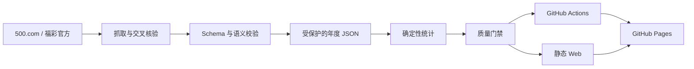

# SSQ Hub · 双色球历史数据分析与可视化

SSQ Hub 是一个面向双色球历史开奖记录的静态数据产品，提供 58 列走势矩阵、
号码画像、统计洞察、研究笔记和多端响应式体验。生产环境不依赖应用服务器、
数据库或前端框架运行时。

> 历史数据只用于查询、统计和可视化，不能预测未来开奖结果。

[](https://github.com/zhouminghan/ssq-hub/actions/workflows/ci.yml)
[](https://github.com/zhouminghan/ssq-hub/actions/workflows/update-data.yml)
[](https://github.com/zhouminghan/ssq-hub/actions/workflows/deploy-pages.yml)
[](https://zhouminghan.github.io/ssq-hub/data/latest.json)
[](LICENSE)

## 功能

- 覆盖 2003 年至今的完整历史开奖记录，支持自动数据抓取、交叉核验和质量门禁。
- 58 列走势矩阵：期号、33 个红球、16 个蓝球和 8 个结构指标。
- 红蓝球遗漏、蓝球 SVG 走势线、近 5 期高亮、最新一期定位和跨年同期对比。
- 号码画像：全局及近期频次、当前遗漏、最大遗漏和最近 5 次出现。
- 数据洞察：分区、奇偶、大小、AC 值、连号、同尾和近期高频号码。
- 研究笔记：站内 Markdown、KaTeX 数学公式、概率图表和期望拆解。
- `auto`、浅色、深色三态主题，响应式表格、冻结期号列和吸顶表头。
- 数据新鲜度、来源核验、CDN 回退和浏览器缓存回退状态。

## 架构



运行层使用原生 HTML、ES Modules、DOM/SVG 和 CSS；公式由本地 KaTeX MathML
渲染。数据契约详见 [数据管道](docs/architecture/DATA_PIPELINE.md)，技术选择
详见 [技术决策](docs/architecture/TECHNICAL_DECISIONS.md)。

## 数据更新

定时任务在开奖日自动更新数据，并在春节等已配置的休市窗口跳过网络请求。空结果、
过期结果或双源冲突会重试，超过上限后明确失败。历史修正只能经过受控的数据管道。

## 本地运行

需要 Python 3.11+ 和 Node.js 20+。安装、启动与首次检查统一记录在
[本地开发指南](docs/development/GETTING_STARTED.md) 中。

## 验证

质量门禁、浏览器测试和本地视觉检查统一记录在
[测试指南](docs/development/TESTING_GUIDE.md) 中。截图只作为本地验证证据，
不提交到 Git。

## 目录

```text
ssq-hub/
├── .github/workflows/   CI、数据更新、修复与 Pages 部署
├── docs/                架构、开发和内容文档
├── schemas/             JSON Schema 2020-12 数据契约
├── scripts/             抓取、统计、清单和验证脚本
├── tests/               unit、python、schema 和 e2e
└── web/
    ├── assets/          图标、Logo 与本地 KaTeX
    ├── config/          停开奖窗口
    ├── content/notes/   站内 Markdown 研究笔记
    ├── css/             主题与组件样式
    ├── data/            年度历史记录和生成数据
    └── js/              浏览器 ES Modules
```

研究长文保留在 `docs/`，站内发布版位于 `web/content/notes/`。公式使用
`$$ ... $$`，图表使用 `:::chart` 指令。升级 KaTeX 后运行 `npm run sync:katex`。

## 部署

项目没有生产构建步骤，GitHub Pages 直接发布 `web/`。工作流按实际文件差异决定
是否部署，并在发布前执行数据与质量检查。详细流程见
[部署指南](docs/development/DEPLOYMENT_GUIDE.md)。

## 兼容与限制

- Chrome 是主测试矩阵，CI 同时覆盖 Firefox 和 WebKit 冒烟测试。
- 一次性渲染全部历史会创建大量 DOM 节点，默认 50 期视图不受影响。
- 下一期日期根据常规开奖规律和已配置休市窗口估算，不覆盖所有临时调整。
- 历史频次只描述过去，不构成预测、推荐或投注建议。

## 贡献

开发、测试与提交流程见 [贡献指南](docs/development/CONTRIBUTING.md)。

## 许可证

本项目采用 [MIT License](LICENSE)，版权所有 © 2026 zhouminghan。
