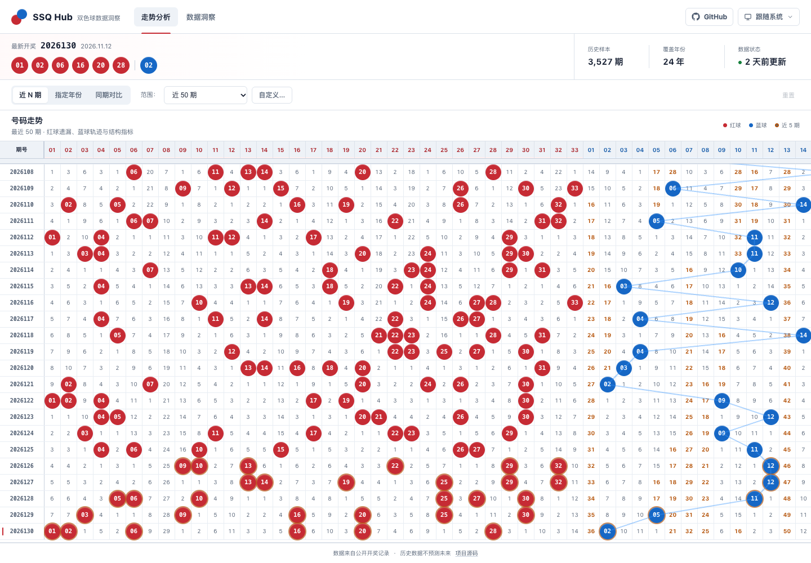
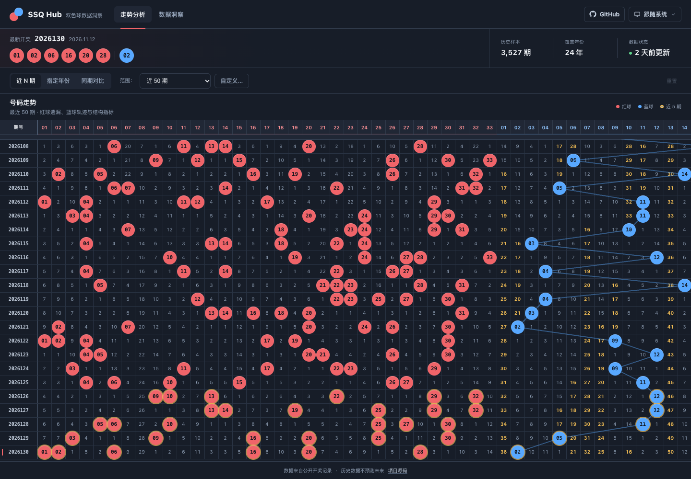
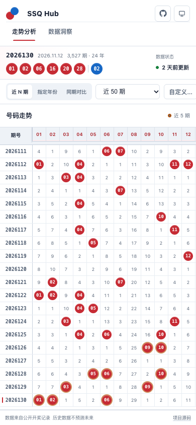
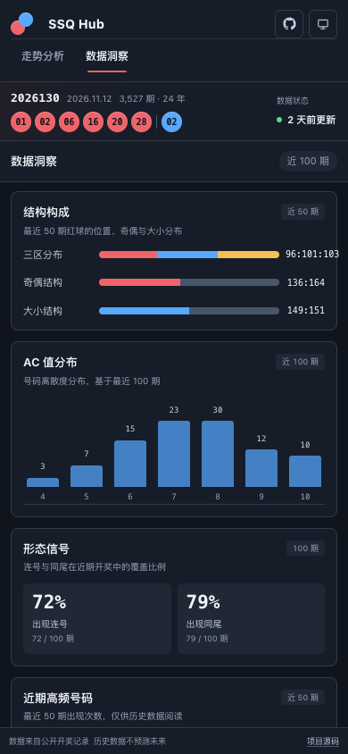
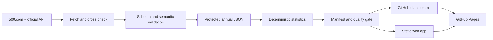

# SSQ Hub

A modern, static Double Color Ball historical data analysis and visualization
platform. SSQ Hub combines an automated Python data pipeline with a responsive
58-column trend view, per-number profiles, recent-frequency statistics, and
light/dark themes.

[](https://github.com/zhouminghan/ssq-hub/actions/workflows/ci.yml)
[](https://github.com/zhouminghan/ssq-hub/actions/workflows/update-data.yml)
[](https://zhouminghan.github.io/ssq-hub/data/latest.json)

## Live Demo

Production URL: <https://zhouminghan.github.io/ssq-hub/>

The application is deployed from the `web/` directory on GitHub Pages. This
reconstruction branch has been validated locally; live deployment verification
requires an authorized push and a successful Pages workflow run.

## Screenshots





<p>
  
  
</p>

## Features

- Full draw history from 2003 through the latest validated issue.
- 58-column trend matrix: issue, 33 red balls, 16 blue balls, and 8 structure
  metrics.
- Red/blue omission values, blue-ball SVG path, recent-five highlight, and
  latest-draw positioning.
- Recent N, year, cross-year comparison, custom N, and reset filters.
- Per-number drawer with global/50/100 frequency, current and maximum omission,
  and the latest five appearances.
- Insights view for zone, odd/even, small/big, AC, consecutive, same-tail, and
  recent high-frequency distributions.
- Auto/light/dark themes applied before first paint and persisted locally.
- Responsive desktop, tablet, and mobile layouts with internal table scrolling,
  frozen issue column, and sticky header.
- Same-origin JSON loading, jsDelivr fallback, timestamped browser cache, and a
  visible offline-cache state.

## Tech Stack

- Runtime: semantic HTML, native ES modules, native DOM/SVG, CSS custom
  properties.
- Data: Python 3.11+, `requests`, JSON Schema 2020-12.
- Quality: TypeScript `checkJs`, ESLint, Node test runner, unittest/pytest,
  Ajv, Playwright, Axe.
- Delivery: GitHub Actions and GitHub Pages.

There is no application server, database, or runtime framework. See
[Technical Decisions](docs/architecture/TECHNICAL_DECISIONS.md) for the measured
architecture decision.

## Architecture



Detailed design:

- [System overview](docs/architecture/SYSTEM_OVERVIEW.md)
- [System architecture](docs/architecture/SYSTEM_ARCHITECTURE.md)
- [Data flow](docs/architecture/DATA_FLOW.md)
- [Frontend architecture](docs/architecture/FRONTEND_ARCHITECTURE.md)
- [Data pipeline](docs/architecture/DATA_PIPELINE.md)
- [CI/CD](docs/architecture/CI_CD.md)

## Project Structure

```text
ssq-hub/
├── .github/workflows/       CI, protected data updates, Pages deployment
├── docs/
│   ├── architecture/        system and contract documentation
│   ├── development/         onboarding and maintenance guides
│   ├── harness/             recoverable task state
│   ├── reports/             baseline, audit, and acceptance evidence
│   └── screenshots/         real product captures
├── schemas/                 JSON Schema 2020-12 contracts
├── scripts/                 ingestion, statistics, manifest, verification
├── tests/
│   ├── e2e/                 Playwright desktop/mobile product tests
│   ├── python/              schema, stats, history, fetch tests
│   ├── schema/              Ajv data validation
│   └── unit/                browser-module unit tests
└── web/
    ├── assets/              favicon and product images
    ├── css/                 theme tokens and component styles
    ├── data/                annual history and generated JSON
    └── js/                  ES module application
```

## Quick Start

```bash
git clone https://github.com/zhouminghan/ssq-hub.git
cd ssq-hub
python3 -m venv .venv
.venv/bin/pip install -r requirements.lock
npm install
npm run dev
```

Open <http://127.0.0.1:5173>.

## Development

Read [AGENTS.md](AGENTS.md) and
[Getting Started](docs/development/GETTING_STARTED.md). Main commands:

```bash
npm run typecheck
npm run lint
npm run test:unit
npm run test:python
npm run test:schema
npm run dev
```

## Data Pipeline

```bash
.venv/bin/python scripts/fetch_latest.py
.venv/bin/python scripts/calc_all.py
.venv/bin/python scripts/verify_data.py
```

Normal updates are append-only. The fetcher cross-checks available sources and
rejects a write when an existing issue conflicts. Authorized corrections use:

```bash
.venv/bin/python scripts/fetch_latest.py \
  --allow-corrections \
  --reason "verified official correction"
.venv/bin/python scripts/update_baseline.py
```

Review `web/data/corrections.json` before refreshing the baseline.

## Data Sources

- [500.com history table](https://datachart.500.com/ssq/)
- [China Welfare Lottery](https://www.cwl.gov.cn/ygkj/wqkjgg/ssq/)

Both sources were reachable during the latest audit and matched the latest 30
records. `idcd.com` was removed because it returned 404 HTML.

## Data Quality

- Strict draw semantics and JSON Schema.
- Unique, ordered issue records with no unexpected yearly gaps.
- Per-record SHA-256 fingerprints in `history_baseline.json`.
- Generated manifest with yearly and full-history hashes.
- Full deterministic stats recomputation and cross-file consistency checks.
- Atomic data-file writes and no-op write suppression.

Run:

```bash
.venv/bin/python scripts/verify_data.py
npm run test:schema
```

## Testing

```bash
npm run check
.venv/bin/python scripts/verify_data.py
npm run test:schema
npx playwright test
npm run test:visual
npm run test:cross-browser
```

Playwright covers startup, data display, all filters, 58 columns, frozen/sticky
layout, number profiles, themes, GitHub entry, 1440/1280/768/390/375 layout,
network failure, cache fallback, and Axe accessibility checks.
Visual baselines run on macOS Chrome. Cross-browser smoke targets Firefox and
WebKit when those Playwright browsers are available.

See [Testing Guide](docs/development/TESTING_GUIDE.md).

## Build

There is no production bundling step. The deployable artifact is `web/`.

## Deployment

Pages deployment is handled by
[deploy-pages.yml](.github/workflows/deploy-pages.yml). Data and frontend
workflows are separated, and deployment is gated by actual commit differences
plus a data verification step.

See [Deployment Guide](docs/development/DEPLOYMENT_GUIDE.md).

## GitHub Actions

| Workflow | Purpose |
|---|---|
| `ci.yml` | lint, typecheck, tests, schema, E2E, dependency audit |
| `update-data.yml` | scheduled/manual protected append and verified commit |
| `data-repair.yml` | explicit reviewed historical correction path |
| `deploy-pages.yml` | verified Pages artifact deployment |

## Theme Support

Auto follows `prefers-color-scheme`. Light and dark are explicit persistent
choices. Both themes use shared design tokens and are browser-tested for
contrast and component consistency.

## Browser Support

Chrome desktop/mobile is covered by the main suite. WebKit mobile passed the
cross-browser smoke locally. Firefox is configured locally and in CI, but the
local managed runtime could not create a browser profile directory. Edge shares
the Chromium engine but was not separately executed. The table depends on native
ES modules, CSS sticky positioning, `ResizeObserver`, and modern CSS custom
properties.

## Contributing

See [CONTRIBUTING.md](docs/development/CONTRIBUTING.md). UI changes require
desktop/mobile screenshots; data changes require Python and schema tests.

## Known Limits

- The first deployment of this reconstruction requires authorized push.
- Remote GitHub Actions and Pages verification is not available before push.
- Rendering all 3,527 rows creates about 448,000 DOM nodes and takes roughly two
  seconds locally. The default 50-row view remains fast; virtualization is not
  currently justified by the default workflow.
- The next draw date is an estimate based on the normal Tue/Thu/Sun schedule and
  does not encode every holiday suspension.
- Historical frequency is descriptive and does not predict future outcomes.

## License

MIT
